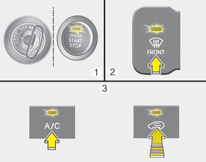

# Kia Sportage: Sistema de controle climático automático

[Início](../../index.md) / [Manual do proprietário do Kia Sportage SL](../sportage-1236.md) / [Características do seu veículo](sportage-1309.md) / [Desnebulamento e desneveamento do para-brisa](sportage-1468.md) / [Lógica de desnebulamento](sportage-1475.md) / Sistema de controle climático automático

1. Coloque a chave do ignição na posição ON.

2. Selecione a posição do desnebulador pressionando o botão do desnebulador ().

).

3. Mantenha pressionado o botão do ar condicionado (A/C) e, em seguida, pressione o botão de controle de entrada de ar pelo menos 5 vezes dentro de 3 segundos.

A tela do A/C piscará 3 vezes com intervalo de 0,5 segundo. Isso indica que a lógica de desnebulamento foi cancelada ou retornou ao status programado.

Se a bateria estiver descarregada ou desconectada, ela será resetada para o status da lógica de desnebulamento.
