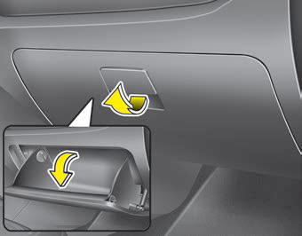

# Kia Sportage: Caixa de luvas

[Início](../../index.md) / [Manual do proprietário do Kia Sportage SL](../sportage-1236.md) / [Características do seu veículo](sportage-1309.md) / [Compartimentos de armazenamento](sportage-1478.md) / Caixa de luvas

Para abrir a caixa de luvas, puxe o puxador e a caixa de luvas se abrirá automaticamente. Feche a caixa de luvas após o uso.

AVISO

*Para reduzir o risco de lesão em acidentes ou freios bruscos, mantenha sempre a caixa de luvas fechada enquanto o veículo estiver em operação.*
