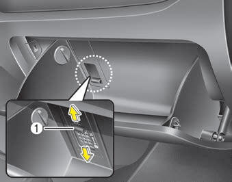

# Kia Sportage: Arrefecimento do compartimento de objetos

[Home](../../index.md) / [Manual do proprietário do Kia Sportage SL](../sportage-1236.md) / [Características do seu veículo](sportage-1309.md) / [Compartimentos de armazenamento](sportage-1478.md) / Arrefecimento do compartimento de objetos

Você pode manter latas de refrigerante ou outros itens frios usando o mecanismo de abertura/fechamento do vento instalado no compartimento de objetos.

1. Ligue o sistema de climatização (A/C).

2. Mova o mecanismo de abertura/fechamento (1) do vento instalado no compartimento de objetos para a posição de abertura.

Quando o cool box não estiver em uso, feche o mecanismo (!

).

*✽ NOTA*

*Enquanto usar a função de arrefecimento, uma pequena quantidade de umidade condensada pode danificar seus documentos.*
