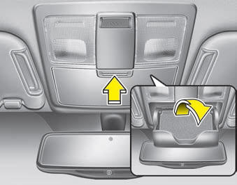

# Kia Sportage: Suporte de óculos de sol

[Home](../../index.md) / [Manual do proprietário do Kia Sportage SL](../sportage-1236.md) / [Características do seu veículo](sportage-1309.md) / [Compartimentos de armazenamento](sportage-1478.md) / Suporte de óculos de sol

Para abrir o suporte de óculos de sol, pressione o cobertor e o suporte se abrirá lentamente. Coloque seus óculos com as lentes voltadas para fora. Para fechar o suporte de óculos de sol, empurre-o para cima.

AVISO - Suporte de óculos de sol

- *Não deixe objetos, exceto óculos de sol, dentro do suporte de óculos de sol. Esses
	objetos podem ser lançados do suporte em caso de frenagem repentina ou acidente,
	potencialmente ferindo os passageiros do veículo.*
- *Não abra o suporte de óculos de sol enquanto o veículo estiver em movimento. O espelho retrovisor do veículo pode ser bloqueado por um suporte de óculos de sol aberto.*
