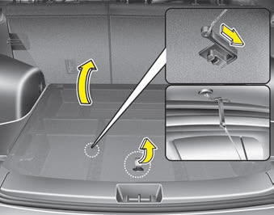

# Kia Sportage: Bagageira

[Início](../../index.md) / [Manual do proprietário do Kia Sportage SL](../sportage-1236.md) / [Características do seu veículo](sportage-1309.md) / [Compartimentos de armazenamento](sportage-1478.md) / Bagageira

Você pode colocar um kit de primeiros socorros, um triângulo refletor, ferramentas, etc. na bagageira para facilitar o acesso.

Agarre o cabo na borda do盖章
assistant
Agarre o cabo na borda do cover e levante-o.
