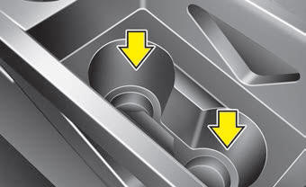
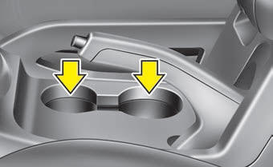
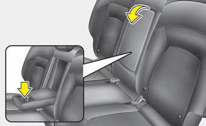

# Kia Sportage: Suporte para copo

[Início](../../index.md) / [Manual do proprietário do Kia Sportage SL](../sportage-1236.md) / [Características do seu veículo](sportage-1309.md) / [Características internas](sportage-1484.md) / Suporte para copo

AVISO - Líquidos quentes

*Não coloque copos sem tampas com líquidos quentes no suporte para copo enquanto o veículo estiver em movimento. Se o líquido derramar, você pode se queimar. Um queimado no condutor pode levar à perda de controle do veículo.*

*✽ NOTA*

*Ao limpar líquidos derramados, não seque o suporte para copo a uma alta temperatura. Isso pode danificar o suporte para copo.*

Tipo A da frente

Tipo B da frente

Traseiro

Copos ou latas de bebida pequenas podem ser colocados nos suportes para copo.
