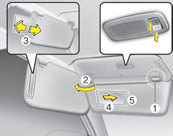

# Kia Sportage: Visor Solar

[Home](../../index.md) / [Manual do proprietário do Kia Sportage SL](../sportage-1236.md) / [Características do seu veículo](sportage-1309.md) / [Recursos internos](sportage-1484.md) / Visor Solar

Use o visor solar para proteger a luz direta através das janelas da frente ou laterais.

Para usar o visor solar, puxe-o para baixo.

Para usar o visor solar para a janela lateral, puxe-o para baixo, desenganche-o do
ganchinho (1) e mova-o para o lado (2).

Ajuste a extensão do visor solar para frente ou para trás (3). (se equipado)

Para usar o espelho de mão, puxe o visor para baixo e deslize o cobertor do espelho (4).

O suporte de bilhete (5) é fornecido para armazenar um bilhete de pedágio. (se equipado)

* O visor solar real no veículo pode diferir da ilustração.

AVISO - Lampada do espelho de mão (se equipado)

* Feche o cobertor do espelho de mão firmemente e retorne o visor solar à sua posição original após o uso. Se você usar a lampada do espelho de mão, desligue-a antes de retornar o visor solar à sua posição original, caso contrário, isso pode resultar na descarga da bateria e possível danos ao visor solar.*
