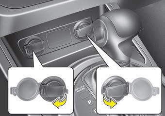
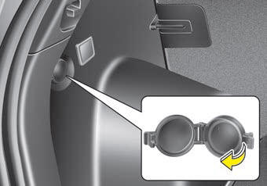

# Kia Sportage: Saída de energia elétrica

[Home](../../index.md) / [Manual do proprietário do Kia Sportage SL](../sportage-1236.md) / [Características do seu veículo](sportage-1309.md) / [Características internas](sportage-1484.md) / Saída de energia elétrica

Front

Rear

A saída de energia elétrica está projetada para fornecer energia para telefones móveis ou outros dispositivos projetados para operar com os sistemas elétricos do veículo. Os dispositivos devem consumir menos de 10 amps com o motor ligado.

- Utilize apenas a saída de energia elétrica quando o motor estiver ligado e retire o cabo do acessório após o uso. Usar o cabo do acessório por períodos prolongados com o motor desligado pode causar a descarga da bateria.
- Utilize apenas acessórios elétricos de 12V com capacidade elétrica inferior a 10A.
- Ajuste o ar-condicionado ou aquecedor ao nível de operação mais baixo ao usar a saída de energia elétrica.
- Feche o capuz quando não estiver em uso.
- Alguns dispositivos eletrônicos podem causar interferência eletrônica quando conectados à saída de energia elétrica do veículo. Esses dispositivos podem causar ruídos excessivos de áudio e mal funcionamento em outros sistemas eletrônicos ou dispositivos OSL040110 utilizados no seu veículo.

AVISO - Choque elétrico

*Não coloque um dedo ou um elemento estranho (lápis, etc.) na saída de energia elétrica e não toque com a mão molhada. Você pode receber um choque elétrico.*
