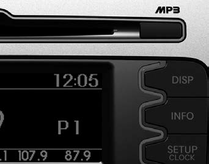

# Kia Sportage: Relógio digital

[Início](../../index.md) / [Manual do proprietário do Kia Sportage SL](../sportage-1236.md) / [Características do seu veículo](sportage-1309.md) / [Características internas](sportage-1484.md) / Relógio digital

Caso os terminais da bateria ou os fusíveis relacionados sejam desconectados, você deve reiniciar
a hora.

Para detalhes, consulte o áudio no final desta seção.

AVISO - Relógios que podem danificar o gancho. Configuração distraída

*Não ajuste o relógio ao dirigir. Tal ajuste pode distraí-lo por tempo demais e levar a um acidente.*
