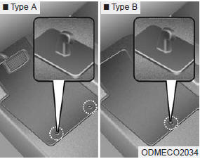

# Kia Sportage: Aparador de tapete no piso

[Home](../../index.md) / [Manual do proprietário do Kia Sportage SL](../sportage-1236.md) / [Características do seu veículo](sportage-1309.md) / [Características internas](sportage-1484.md) / Aparador de tapete no piso

Ao usar um tapete no piso do carpete, certifique-se de que ele esteja fixado nos aparadores de tapete no piso do seu veículo. Isso evita que o tapete deslize para frente.

O que deve ser observado ao instalar QUALQUER tapete no veículo:

- Certifique-se de que os tapetes estejam firmemente fixados nos aparadores de tapete do veículo antes de dirigir o veículo.
- Não use QUALQUER tapete que não possa ser firmemente fixado nos aparadores de tapete do veículo.
- Não empilhe tapetes um sobre o outro (por exemplo, um tapete de borracha all-weather sobre um tapete de carpete). Só deve ser instalado um único tapete em cada posição.

IMPORTANTE - Seu veículo foi fabricado com aparadores de tapete no lado do motorista projetados para segurar firmemente o tapete em seu lugar. Para evitar qualquer interferência na operação dos pedais, a Kia recomenda que apenas o tapete Kia projetado para uso no seu veículo seja instalado.

AVISO - Tapete de piso aftermarket

*Não instale tapetes aftermarket que não possam ser firmemente fixados nos aparadores de tapete do veículo. Tapetes não fixados podem interferir na operação dos pedais.*
