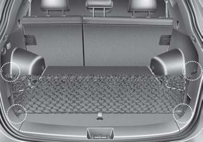
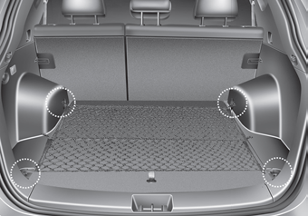

# Kia Sportage: Suporte para redes de bagagem

[Home](../../index.md) / [Manual do proprietário do Kia Sportage SL](../sportage-1236.md) / [Características do seu veículo](sportage-1309.md) / [Características internas](sportage-1484.md) / Suporte para redes de bagagem

Para evitar que os itens se movimentem no compartimento de bagagem, você pode usar os suportes localizados no compartimento de bagagem para fixar a rede de bagagem.

Se necessário, entre em contato com seu concessionário autorizado Kia para obter uma rede de bagagem.

AVISO - Rede de bagagem

*Sempre mantenha o seu rosto e corpo fora do caminho de retorno da rede de bagagem e evite usar a rede de bagagem quando as correias apresentarem sinais visíveis de desgaste ou danos. A rede de bagagem pode se romper e causar ferimentos.*
