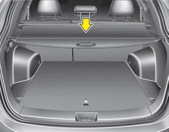
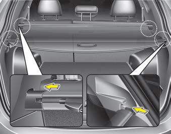
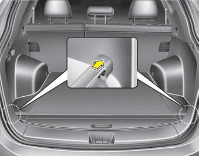

# Kia Sportage: Telha de segurança do compartimento de carga

[Home](../../index.md) / [Manual do proprietário do Kia Sportage SL](../sportage-1236.md) / [Características do seu veículo](sportage-1309.md) / [Características internas](sportage-1484.md) / Telha de segurança do compartimento de carga

Use a telha de segurança do compartimento de carga para esconder itens armazenados na área de carga.

Para usar a telha de segurança do compartimento de carga, puxe o gancho para trás e insira as bordas nas ranhuras.

Quando não estiver em uso, coloque a telha de segurança do compartimento de carga na parte inferior da área de carga.

AVISO - Telha de segurança do compartimento de carga

*Não coloque objetos na telha de segurança do compartimento de carga. Esses objetos podem ser arremessados dentro do veículo e possivelmente lesar os ocupantes do veículo em caso de acidente ou freio brusco.*

CUIDADO

*Como a telha de segurança do compartimento de carga pode ser danificada ou deformada, não coloque as malas nela quando estiver em uso.*
