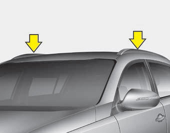
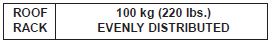

# Kia Sportage: Roof Rack

[Início](../../index.md) / [Manual do proprietário do Kia Sportage SL](../sportage-1236.md) / [Características do seu veículo](sportage-1309.md) / [Características externas](sportage-1493.md) / Roof Rack

Se o veículo tiver um roof rack, você pode carregar carga no topo do veículo.

*✽ NOTA*

*Se o veículo estiver equipado com um telhado solar, certifique-se de não posicionar a carga no roof rack de maneira que possa interferir na operação do telhado solar.*

CUIDADO - Carregando roof rack

*Ao transportar carga no roof rack, tome as precauções necessárias para garantir que a carga não danifique o teto do veículo.*

- Ao transportar objetos grandes no roof rack, certifique-se de que eles não ultrapassem a largura ou o comprimento total do teto.
- Ao transportar carga no roof rack, não operar o telhado solar (se equipado).
- A seguir, está a especificação do peso máximo que pode ser carregado no roof rack. Distribua a carga o mais uniformemente possível no roof rack e fixe-a firmemente.

Carregar carga ou bagagem em excesso do limite de peso especificado no roof rack pode danificar seu veículo. Ventos fortes, causados por veículos passantes ou causas naturais, podem causar uma pressão repentina para cima nos itens carregados no roof rack. Isso é especialmente verdadeiro ao transportar itens grandes e planos, como painéis de madeira ou colchões.

AVISO - Dirigindo com carga no teto

*Sempre dirija devagar e torne-se cuidadoso ao fazer curvas quando transportar itens no teto. O centro de gravidade do veículo será mais alto quando itens forem carregados no teto.*

Isso pode causar os itens a caírem do roof rack e danificar seu veículo ou outras pessoas ao seu redor.

- Para prevenir danos ou perda de carga ao dirigir, verifique frequentemente antes ou durante a viagem para garantir que os itens no roof rack estejam firmemente fixados.
