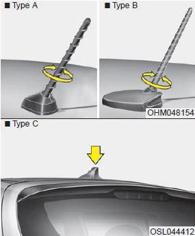

# Kia Sportage: Antena

[Início](../../index.md) / [Manual do Proprietário do Kia Sportage SL](../sportage-1236.md) / [Características do seu veículo](sportage-1309.md) / [Sistema de áudio](sportage-1495.md) / Antena

**Tipo A, B**

Seu veículo usa uma antena no teto para receber sinais de rádio AM e FM.

Esta antena é removível. Para remover a antena no teto, vire-a no sentido horário.
Para instalar a antena no teto, vire-a no sentido anti-horário.

**Tipo C**

Seu veículo usa uma antena no teto para receber sinais de rádio AM e FM.

- Antes de entrar em um local com baixa altura ou em uma lavagem de carros, remova
	a antena girando-a no sentido anti-horário. Caso contrário, a antena pode ser danificada.
- Ao reinstalar a antena no teto do veículo, é importante que ela esteja totalmente apertada
	e ajustada na posição vertical para garantir uma recepção adequada. No entanto, ela pode
	ser removida quando o veículo estiver estacionado ou quando carregarem carga no rack do teto.
- Quando carregarem carga no rack do teto, não coloquem a carga perto da antena
	pole para garantir uma recepção adequada.
