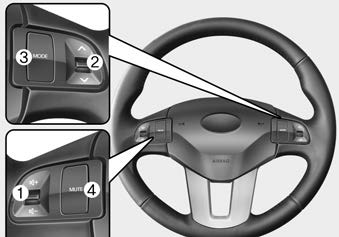
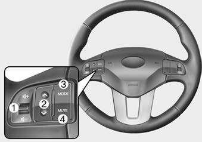

# Kia Sportage: Controles de áudio no volante

[Home](../../index.md) / [Manual do proprietário do Kia Sportage SL](../sportage-1236.md) / [Características do seu veículo](sportage-1309.md) / [Sistema de áudio](sportage-1495.md) / Controles de áudio no volante

Tipo A

Tipo B

O volante pode incluir botões de controle de áudio.

*✽ NOTA*

*Não operar simultaneamente os botões de controle remoto de áudio.*

Dirigir distraído é perigoso e deve ser evitado. Os motoristas devem manter-se atentos à direção e sempre exercer cautela ao usar os controles montados no volante enquanto estão em movimento.

**VOLUME (  /
 ) (1)**

- Pressione o lembrete para cima ( **** ) para aumentar o volume.
- Pressione o lembrete para baixo ( **** ) para diminuir o volume.

SEEK/PRESET (

/

) (2)

O botão SEEK/PRESET tem funções diferentes com base no modo do sistema. Para as seguintes funções, o botão deve ser pressionado por 1 segundo ou mais.

**MODELO DE RÁDIO**

Funcionará como o botão AUTO SEEK select.

**MODELO CD/USB/iPod®**

Funcionará como o botão FF/REW.

Se o botão SEEK/PRESET for pressionado por menos de 1 segundo, funcionará da seguinte forma em cada modo.

**MODELO DE RÁDIO**

Funcionará como os botões PRESET STATION.

**MODELO CD/USB/iPod®**

Funcionará como o botão TRACK UP/DOWN.

**MODE (3)**

Pressione o botão para alterar a fonte de áudio.

FM(1~2)➟AM➟SAT(1~3)➟CD➟USB AUX(iPod)➟FM...

**MUTE (4)**

- Pressione o botão para silenciar o som.
- Pressione o botão para desligar o microfone durante uma chamada telefônica.

Informações detalhadas sobre os botões de controle de áudio estão descritas nas páginas seguintes nesta seção.
