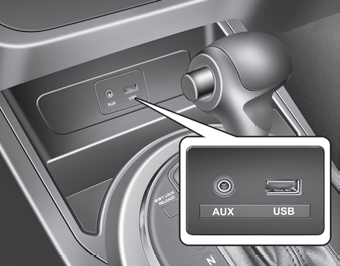

# Kia Sportage: Aux, USB e porta iPod®

[Início](../../index.md) / [Manual do proprietário do Kia Sportage SL](../sportage-1236.md) / [Características do seu veículo](sportage-1309.md) / [Sistema de áudio](sportage-1495.md) / Porta aux, USB e iPod®

Se o seu veículo tiver uma porta auxiliar e/ou porta USB ou porta iPod®, você pode conectar dispositivos de áudio à porta auxiliar e conectar um dispositivo USB à porta USB e também conectar um iPod® à porta iPod®.

*NOTA*

*Quando você usar um dispositivo de áudio portátil conectado à tomada de energia, pode ocorrer ruídos durante a reprodução. Se isso acontecer, use a fonte de energia do dispositivo de áudio portátil.*

* iPod® é uma marca registrada da Apple Inc.

Dispositivo iPod® móvel vendido separadamente. A conectividade pode exigir o uso da fiação de acessório da Kia.

AVISO - Condução distraída

*Conduzir distraído pode resultar em perda de controle do veículo, o que pode levar a um acidente, lesões graves e mortes. A principal responsabilidade do condutor é a condução segura e legal do veículo, e o uso de qualquer dispositivo de mão, equipamento adicional ou sistemas do veículo que tirem a atenção do condutor do controle seguro do veículo ou que não estejam permitidos por lei nunca devem ser usados durante a condução do veículo.*
