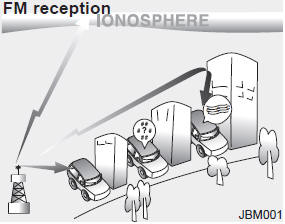
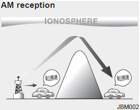
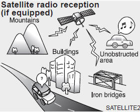
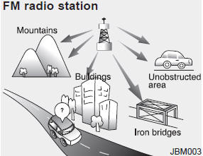
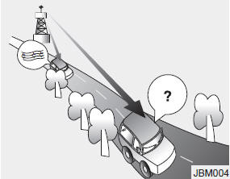
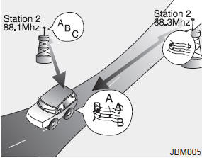

# Kia Sportage: Como o som do veículo funciona

[Home](../../index.md) / [Manual do proprietário Kia Sportage SL](../sportage-1236.md) / [Características do seu veículo](sportage-1309.md) / [Sistema de áudio](sportage-1495.md) / Como o som do veículo funciona

Sinais de rádio AM e FM são transmitidos de torres de transmissão localizadas em sua cidade. Esses sinais são capturados pelo antena do rádio do seu veículo. A partir daí, o sinal é recebido pelo rádio e enviado para os alto-falantes do seu veículo.

Quando um sinal de rádio forte chega ao seu veículo, o engenheiramento preciso do seu sistema de áudio garante a melhor qualidade possível de reprodução. No entanto, em alguns casos, o sinal recebido pelo seu veículo pode não ser forte e claro.

Isso pode ser devido a fatores como a distância da estação de rádio, a proximidade de outras estações de rádio fortes ou a presença de prédios, pontes ou outras grandes obstruções na área.

Os sinais de rádio AM podem ser recebidos a distâncias maiores do que os sinais FM. Isso ocorre porque as ondas de rádio AM são transmitidas em baixas frequências. Essas ondas de rádio de longa distância e baixa frequência podem seguir a curvatura da Terra em vez de viajar em linha reta. Além disso, elas se curvam ao redor de obstruções, resultando em melhor cobertura do sinal.

A recepção de rádio por satélite requer uma linha de visão direta com o satélite transmitindo o sinal de rádio.

Túneis, pontes, estacionamentos cobertos, terrenos montanhosos, prédios altos, vegetação densa e outras obstruções podem interromper temporariamente o sinal. Isso é uma operação normal, e a recepção será restaurada após alguns segundos.

O sinal pode se tornar fraco em algumas áreas que não estão cobertas pela rede de repetidores Sirius.

Os sinais FM são transmitidos em altas frequências e não se curvam para seguir a superfície da Terra. Por isso, os sinais FM geralmente começam a se desvanecer em distâncias curtas da estação. Além disso, os sinais FM são facilmente afetados por prédios, montanhas e obstruções. Isso pode levar a condições de audição indesejáveis ou desagradáveis, que podem fazer você acreditar que há um problema com o seu rádio. As seguintes condições são normais e não indicam problemas com o rádio:

- Desvanecimento - À medida que seu veículo se afasta da estação de rádio, o sinal se enfraquecerá e o som começará a desvanecer. Quando isso ocorrer, sugerimos que você selecione outra estação mais forte.
- Flutter/Estática - Sinais FM fracos ou grandes obstruções entre a torre de transmissão e seu rádio podem perturbar o sinal, causando estática ou ruídos de flutter. Reduzir o nível do agudo pode diminuir esse efeito até que a perturbação se esclua.

- Troca de Estações - À medida que o sinal FM se enfraquece, outro sinal mais forte na mesma frequência pode começar a ser transmitido. Isso ocorre porque seu rádio está projetado para

to lockar na sinal mais clara. Se isso ocorrer, selecione outra estação com
	um sinal mais forte.
- Cancelamento de Multi-Caminho - Sinais de rádio recebidos de várias direções
	podem causar distorção ou oscilação. Isso pode ser causado por um sinal direto e refletido
	da mesma estação, ou por sinais de duas estações com frequências próximas.
	Se isso ocorrer, selecione outra estação até que a condição tenha passado.

**Usando um telefone celular ou um rádio de duas vias**

Quando um telefone celular é usado dentro do veículo, pode haver ruídos no sistema de áudio. Isso não significa que há algo errado com o equipamento de áudio.
Nesse caso, tente operar dispositivos móveis o mais longe possível do equipamento de áudio.

Quando se usa um sistema de comunicação, como um telefone celular ou um rádio, dentro do veículo, é necessário montar um anteparo externo separado. Quando um telefone celular ou um rádio é usado com apenas um anteparo interno, pode haver interferência no sistema elétrico do veículo e afetar negativamente a operação segura do veículo.

AVISO - Uso de telefone celular

*Não use um telefone celular ao dirigir. Pare em um local seguro para usar
um telefone celular.*
