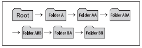
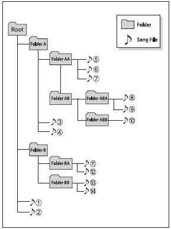

# Kia Sportage: Cuidando do disco

[Home](../../index.md) / [Manual do proprietário do Kia Sportage SL](../sportage-1236.md) / [Características do seu veículo](sportage-1309.md) / [Sistema de áudio](sportage-1495.md) / Cuidando do disco

- Se a temperatura dentro do carro estiver muito alta, abra as janelas para ventilar antes de usar o sistema.
- É ilegal copiar e usar arquivos MP3/WMA sem permissão. Use CDs criados apenas por meios legais.
- Não aplique agentes voláteis, como benzeno e dissolvente, limpadores normais e sprays magnéticos feitos para discos analógicos nos CDs.
- Para prevenir danos à superfície do disco, segure os CDs apenas pelas bordas ou o buraco central.
- Limpe a superfície do disco com uma toalha macia antes de tocar (esfregue-a do centro para a borda externa).
- Não danifique a superfície do disco ou cole fitas adesivas ou papel nele.
- Certifique-se de que apenas CDs sejam inseridos no player de CD (não insira mais de um CD por vez).
- Manter os CDs em suas caixas após o uso para protegê-los de arranhões ou sujeira.
- Dependendo do tipo de CDR/CD-RW, alguns CDs podem não funcionar normalmente conforme as empresas fabricantes. Nesses casos, o uso contínuo pode causar mal funcionamento no seu sistema de áudio.

*NOTA - Reproduzindo um Disco Protegido Incompatível*

*Alguns discos protegidos por cópias, que não estão de acordo com os padrões internacionais de CD de áudio (Red Book), podem não reproduzir no seu sistema de áudio do carro. Note que a incapacidade de reproduzir um disco protegido por cópias pode indicar que o CD está defeituoso, não o player de CD.*

NOTA:

Ordem de reprodução de arquivos (pastas):

1. Ordem de reprodução das músicas: 1 a 14 sequencialmente.

2. Ordem de reprodução das pastas:

❋ Se não houver arquivo de música na pasta, essa pasta não será exibida.

AVISO - Distração do Motorista

- *Não olhe para a tela enquanto está dirigindo. Olhar para a tela por períodos prolongados pode levar a acidentes de trânsito.*
- *Usar o telefone enquanto está dirigindo pode levar a uma falta de atenção às condições de trânsito e aumentar a probabilidade de acidentes. Use a função do telefone após parar o veículo.*

AVISO - Sistema de Áudio

*Não desmonte, monte ou modifique o sistema de áudio. Tais ações podem resultar em incêndio ou choque elétrico.*

AVISO - Antena

*Não toque na antena durante trovões ou relâmpagos, pois tais ações podem levar a choques elétricos causados por relâmpagos.*

CAUTION

*Não use se a tela estiver em branco ou não for possível ouvir som, pois esses sinais podem indicar falha no produto.*

- Ajuste o volume para níveis que permitam ao motorista ouvir sons do exterior do veículo. Dirigir em um estado em que os sons externos não podem ser ouvidos pode levar a acidentes.
- Preste atenção à configuração do volume ao ligar o dispositivo. Um ajuste repentino

um volume extremo ao ligar o dispositivo pode causar comprometimento da audição.
(Adapte o volume para níveis apropriados antes de desligar o dispositivo.)

*✽ NOTA*

*Consulte o local de compra ou centro de manutenção antes de mudar a posição de qualquer dispositivo instalado no seu sistema de áudio. Experiência técnica é necessária para desmontar e/ou instalar esses dispositivos.*

CAUÇÃO

*Não submeta o dispositivo a choques ou impactos severos. Pressão direta na frente do monitor pode causar danos ao LCD ou à tela tátil.*

CAUÇÃO - Limpeza do dispositivo

- *Ao limpar o dispositivo, certifique-se de desligá-lo e usar um pano seco e liso.*
- *Nunca use materiais durões, pano químico ou solventes (álcool, benzeno, dissolventes, etc.), pois tais materiais podem danificar a placa do dispositivo ou causar deterioração de cor e qualidade.*
- *Evite que soluções causticas, como perfume e óleo cosmético, entrem em contato com o painel para evitar danos ou descoloração.*

- Ligue o ignição do carro antes de usar este dispositivo. Não operar o sistema de áudio por períodos prolongados com o ignição desligada, pois tal operação pode levar à descarga da bateria.
- Em caso de falha no produto, entre em contato com o local de compra ou centro de pós-venda.
- Posicionar o sistema de áudio em um ambiente comum de campo eletromagnético pode resultar em interferência de som.
