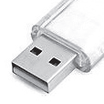

# Kia Sportage: USANDO O DISPOSITIVO USB

[Home](../../index.md) / [Manual do proprietário Kia Sportage SL](../sportage-1236.md) / [Características do seu veículo](sportage-1309.md) / [Sistema de áudio](sportage-1495.md) / USANDO O DISPOSITIVO USB

- Para usar um dispositivo USB externo, certifique-se de que o dispositivo não esteja conectado ao ligar o veículo. Conecte o dispositivo após ligar o veículo.
- Se você ligar o motor com o dispositivo USB conectado, pode danificar o dispositivo USB. (Os pendrives USB são muito sensíveis a choques elétricos.)
- Se o motor for ligado ou desligado enquanto o dispositivo USB externo estiver conectado, o dispositivo USB externo pode não funcionar.
- O sistema pode não reproduzir arquivos MP3 ou WMA não autenticados.

	1) Ele pode reproduzir apenas arquivos MP3 com taxa de compressão entre 8Kbps ~ 320Kbps.

	2) Ele pode reproduzir apenas arquivos de música WMA com taxa de compressão entre 8Kbps ~ 320Kbps.
- Cuide da eletricidade estática ao conectar ou desconectar o dispositivo USB externo.
- Um gravador de MP3 criptografado não será reconhecido.
- Dependendo da condição do dispositivo USB externo, o dispositivo USB externo conectado pode não ser reconhecido.
- Se a configuração formatada em bytes/setor do dispositivo USB externo não for nem 512BYTE nem 2048BYTE, o dispositivo não será reconhecido.
- Use apenas dispositivos USB formatados para FAT 12/16/32.
- Dispositivos USB sem autenticação de interface USB I/F podem não ser reconhecidos.
- Certifique-se de que o terminal de conexão USB não entre em contato com o corpo humano ou outros objetos. • Se você conectar ou desconectar repetidamente o dispositivo USB em um curto período de tempo, pode quebrar o dispositivo.
- Você pode ouvir um som estranho ao conectar ou desconectar um dispositivo USB.
- Se você desconectar o dispositivo USB externo durante a reprodução no modo USB, o dispositivo USB externo pode ser danificado ou pode falhar. Portanto, desconecte o dispositivo USB externo quando o áudio estiver desligado ou em outro modo. (por exemplo, Rádio, CD)
- Dependendo do tipo e capacidade do dispositivo USB externo ou do tipo dos arquivos armazenados no dispositivo, há uma diferença no tempo de reconhecimento do dispositivo.
- Não use o dispositivo USB para fins diferentes de reproduzir arquivos de áudio.
- A reprodução de vídeos através do USB não é suportada.
- O uso de acessórios USB como carregadores ou aquecedores usando a interface USB I/F pode reduzir o desempenho ou causar problemas.
- Se você usar dispositivos como um hub USB adquirido separadamente, o sistema de áudio do veículo pode não reconhecer o dispositivo USB. Nesse caso, conecte o dispositivo USB diretamente ao terminal multimídia do veículo.
- Se o dispositivo USB for dividido em unidades lógicas, apenas os arquivos de música na unidade com prioridade mais alta são reconhecidos pelo sistema de áudio do carro.
- Dispositivos como gravador de MP3/celular/câmera digital podem não ser reconhecidos pela interface USB padrão.
- A recarga através do USB pode não ser suportada em alguns dispositivos móveis.
- Tipos de HDD USB ou USB propensos a falhas de conexão devido a vibrações do veículo (tipo i-stick) não são suportados.

- Alguns dispositivos USB não padrão (TIPO DE CAPA METÁLICA USB) podem não ser reconhecidos.
- Alguns leitores de memória USB (como CF, SD, micro SD, etc.) ou dispositivos tipo HDD externo podem não ser reconhecidos.
- Arquivos de música protegidos por DRM (GERENCIAMENTO DE DIREITOS DE USO DIGITAL) não são reconhecidos.
- Os dados na memória USB podem ser perdidos ao usar este áudio. Sempre faça backup de dados importantes em um dispositivo de armazenamento pessoal.
- Evite o uso de
produtos de memória USB que podem ser usados como chaves de cadeado ou acessórios de celular, pois eles podem causar danos à porta USB. Certifique-se de usar apenas produtos com conectores plug.
