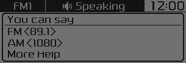
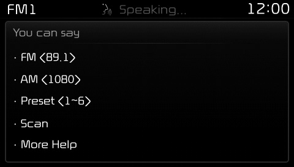
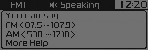
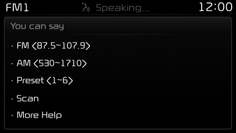

# Kia Sportage: Reconhecimento de Voz

[Início](../../index.md) / [Manual do Proprietário do Kia Sportage SL](../sportage-1236.md) / [Características do seu veículo](sportage-1309.md) / [Sistema de áudio](sportage-1495.md) / Reconhecimento de Voz

- Quando usar a função de reconhecimento de voz, apenas comandos listados na
	manual do usuário são suportados.
- Tenha em mente que durante a operação do sistema de reconhecimento de voz, pressionar
	qualquer tecla exceto a tecla para encerrar o modo de reconhecimento de voz.
- Para um melhor desempenho do reconhecimento de voz, posicione o microfone usado
	para o reconhecimento de voz acima da cabeça do assento do motorista e mantenha uma posição adequada
	quando emitir comandos.
- Em situações nas seguintes, o reconhecimento de voz pode não funcionar corretamente
	devido a som externo.

	- Quando os vidros e o teto solar estiverem abertos

	- Quando o vento do sistema de ar condicionado / aquecimento for forte

	- Quando entrar e passar por túneis

	- Quando dirigir em estradas irregulares e desníveis

	- Durante fortes chuvas (chuvas intensas, tempestades de vento)
- Comandos relacionados ao telefone podem ser usados apenas quando um dispositivo
	de tecnologia sem fio Bluetooth® estiver conectado.
- Ao fazer ligações mencionando um nome, o contato correspondente deve estar baixado
	e armazenado no sistema de áudio.
- Após o download do catálogo telefônico da tecnologia sem fio Bluetooth®, leva
	algum tempo para converter os dados do catálogo telefônico em informações de voz. Durante este
	tempo, o reconhecimento de voz pode não funcionar corretamente.
- Pronuncie os comandos de voz naturalmente e claramente, como se estivesse em uma conversa normal.

O manual de Bluetooth e Reconhecimento de Voz está fornecido em duas versões devido
às diferenças de versão do software. Antes de ler o manual, verifique o seguinte.

Pressione o

no painel de rádio FM.

1. Se você encontrar “FM <89.1>” na tela,

2. Se você encontrar “FM <87.5~107.9>” na tela

