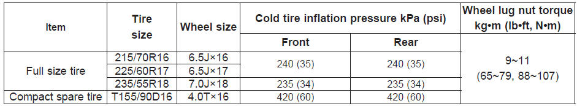

# Kia Sportage: Pneus e rodas

[Home](../../index.md) / [Manual do proprietário Kia Sportage SL](../sportage-1236.md) / [Especificações e informações ao consumidor](sportage-1702.md) / Pneus e rodas

CAUTION

*Ao substituir pneus, use o mesmo tamanho fornecido originalmente com o veículo.
Usar pneus de tamanhos diferentes pode danificar as partes relacionadas ou fazer com que funcionem irregularmente.*

*✽ NOTA*

*Recomendamos que, ao substituir pneus, use o mesmo fornecido originalmente com
o veículo. Caso contrário, isso afeta o desempenho de direção.*
