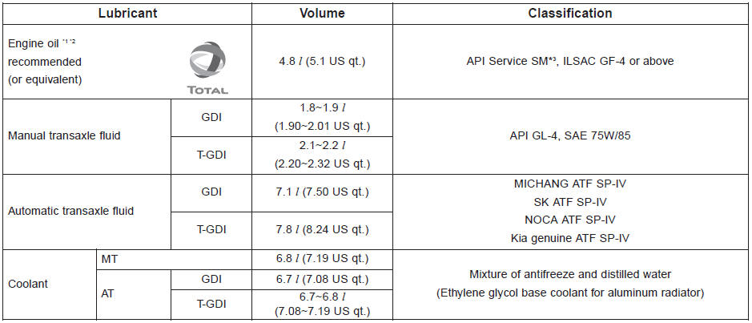
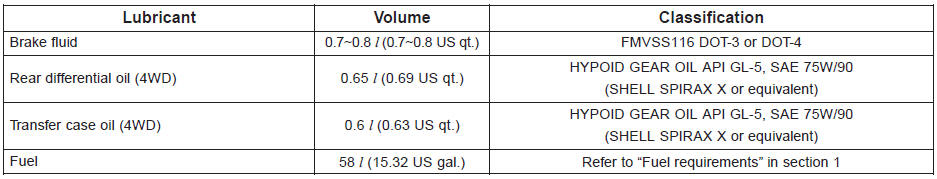

# Kia Sportage: Lubrificantes recomendados e capacidades

[Início](../../index.md) / [Manual do Proprietário Kia Sportage SL](../sportage-1236.md) / [Especificações e Informações ao Consumidor](sportage-1702.md) / Lubrificantes recomendados e capacidades

Para garantir o desempenho e a durabilidade adequados do motor e da transmissão, utilize apenas lubrificantes de qualidade correta. Os lubrificantes corretos também ajudam a promover a eficiência do motor, resultando em maior economia de combustível.

Estes lubrificantes e fluidos são recomendados para uso no seu veículo.

*1 Consulte os números de viscosidade SAE recomendados na próxima página.

*2 Agora estão disponíveis óleos de motor com etiqueta de Economia de Energia. Além de outros benefícios adicionais, eles contribuem para a economia de combustível ao reduzir a quantidade de combustível necessária para superar a fricção do motor. Às vezes, essas melhorias são difíceis de medir em uma condução diária, mas em um ano, podem oferecer significativas economias de custo e energia.

*3 Se o óleo de motor API serviço SM não estiver disponível em seu país, você pode usar o óleo de motor API serviço SL.

MT : Transmissão manual

AT : Transmissão automática

- [Número de viscosidade SAE recomendado](sportage-1708.md)
