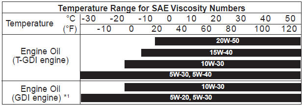

# Kia Sportage: Número de viscosidade recomendado SAE

[Home](../../index.md) / [Manual do proprietário Kia Sportage SL](../sportage-1236.md) / [Especificações e informações ao consumidor](sportage-1702.md) / [Lubrificantes recomendados e capacidades](sportage-1707.md) / Número de viscosidade recomendado SAE

Sempre limpe a área ao redor de qualquer válvula de enchimento, válvula de drenagem ou barra de nível de óleo antes de verificar ou drenar qualquer lubrificante. Isso é especialmente importante em áreas poluídas ou arenosas e quando o veículo é usado em estradas não asfaltadas. Limpar as áreas da válvula e da barra de nível de óleo impedirá que sujeira e areia entrem no motor e em outras mecanismos que poderiam ser danificados.

A viscosidade do óleo do motor (espessura) tem um efeito na economia de combustível e no funcionamento em baixas temperaturas (início do motor e fluidez do óleo do motor). Óleos de motor com viscosidade mais baixa podem proporcionar melhor economia de combustível e desempenho em baixas temperaturas, no entanto, óleos de motor com viscosidade mais alta são necessários para lubrificação satisfatória em temperaturas mais quentes. Usar óleos de qualquer viscosidade diferente das recomendadas pode resultar em danos ao motor.

Ao escolher um óleo, considere o intervalo de temperatura em que o veículo será operado antes da próxima troca de óleo. Prossiga para selecionar a viscosidade de óleo recomendada do gráfico.

*1 Para melhor economia de combustível, é recomendado o uso de óleo de motor de viscosidade grade SAE 5W-20 (API SM / ILSAC GF-4). No entanto, se o óleo de motor não estiver disponível em seu país, selecione o óleo de motor apropriado usando o gráfico de viscosidade de óleo do motor.
