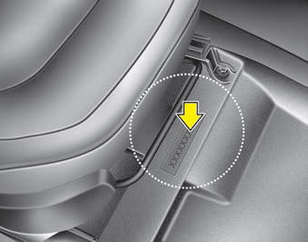
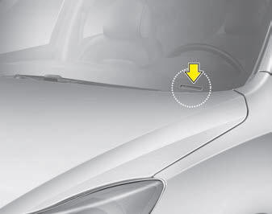

# Kia Sportage: Número de identificação do veículo (VIN)

[Home](../../index.md) / [Manual do proprietário Kia Sportage SL](../sportage-1236.md) / [Especificações e informações ao consumidor](sportage-1702.md) / Número de identificação do veículo (VIN)

Número do chassi

O número de identificação do veículo (VIN) é o número usado para registrar seu
veículo e em todas as matérias legais relacionadas à sua propriedade, etc.

O número está estampado no chão, abaixo do banco do passageiro frontal. Para verificar o número, abra o revestimento do tapete.

Etiqueta do VIN

O VIN também está em uma placa fixada no topo do painel de instrumentos. O número na placa pode ser facilmente visto através do para-brisa, do lado de fora.
