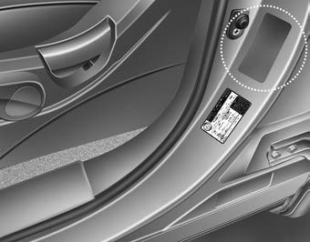

# Kia Sportage: Rótulo de certificação do veículo

[Home](../../index.md) / [Manual do proprietário Kia Sportage SL](../sportage-1236.md) / [Especificações e informações ao consumidor](sportage-1702.md) / Rótulo de certificação do veículo

O rótulo de certificação do veículo, anexado ao pilar central do lado do motorista, fornece o número de identificação do veículo (VIN).
