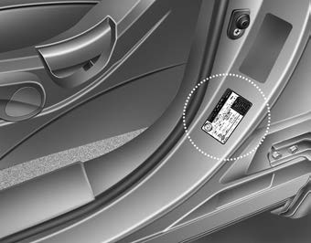

# Kia Sportage: Espécie de pneu e etiqueta de pressão

[Home](../../index.md) / [Manual do proprietário Kia Sportage SL](../sportage-1236.md) / [Especificações e informações ao consumidor](sportage-1702.md) / Espécie de pneu e etiqueta de pressão

Os pneus fornecidos no seu veículo novo foram escolhidos para proporcionar o melhor desempenho
para o uso normal.

A etiqueta de pneu localizada no pilar central do lado do motorista fornece as pressões de pneu
recomendadas para o seu veículo.
