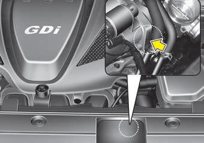
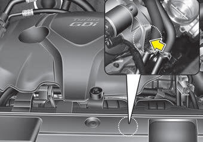

# Kia Sportage: Número do motor

[Home](../../index.md) / [Manual do proprietário Kia Sportage SL](../sportage-1236.md) / [Especificações e informações ao consumidor](sportage-1702.md) / Número do motor

Motor GDI

Motor T-GDI

O número do motor está estampado no bloco do motor conforme ilustrado.
