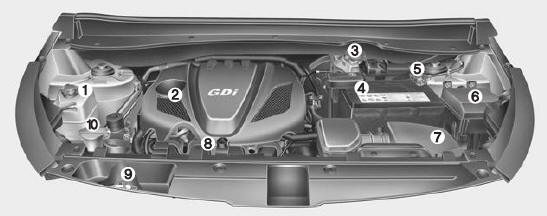
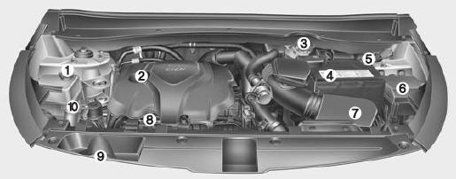

# Kia Sportage: Compartment do Motor

[Home](../../index.md) / [Manual do proprietário Kia Sportage SL](../sportage-1236.md) / [Manutenção](sportage-1629.md) / Compartment do Motor

Motor GDI

Motor T-GDI

1. Reservatório de líquido de arrefecimento do motor

2. Capo de adição de óleo do motor

3. Reservatório de líquido de freio/embreagem*

4. Terminal positivo da bateria

5. Terminal negativo da bateria

6. Caixa de fusíveis

7. Filtro de ar

8. Escalpelômetro de óleo do motor

9. Capo do radiador

10. Reservatório de líquido limpador de para-brisa
