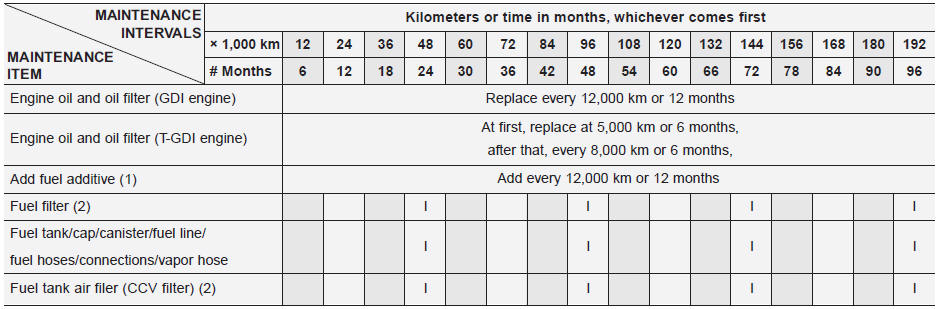
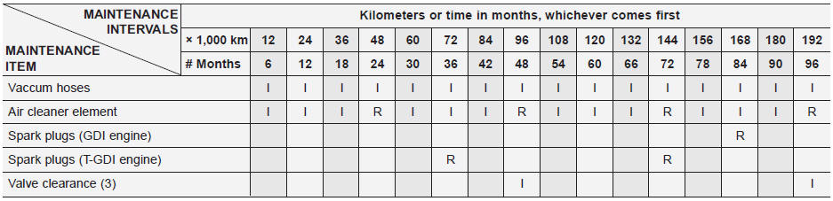
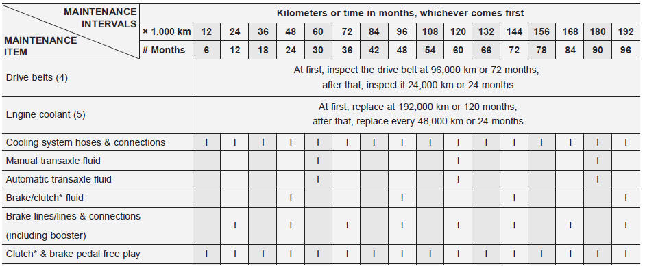
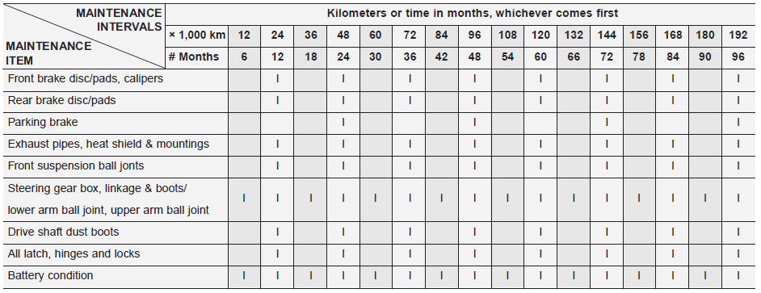
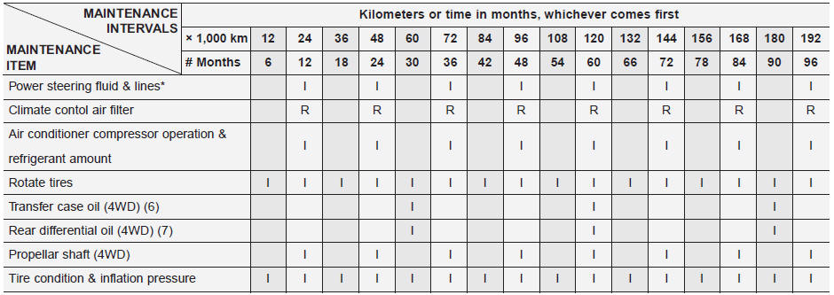

# Manutenção normal do Kia Sportage: Agende regularmente

[Início](../../index.md) / [Manual do Proprietário do Kia Sportage SL](../sportage-1236.md) / [Manutenção](sportage-1629.md) / Agende regularmente a manutenção

Os seguintes serviços de manutenção devem ser realizados para garantir um bom controle de emissões e desempenho. Manter recibos de todos os serviços de emissões do veículo pode proteger sua garantia. Quando ambos, quilometragem e tempo, são mostrados, a frequência do serviço é determinada pelo que ocorrer primeiro.

R : Substituir ou trocar

I : Inspecionar e, se necessário, ajustar, corrigir, limpar ou substituir.

(1) Se não estiver disponível Detergente de Combustível de Qualidade Superior, uma garrafa de aditivo é recomendada. Aditivos estão disponíveis no seu concessionário autorizado Kia, junto com informações sobre como utilizá-los. Não misture outros aditivos.

(2) O filtro de combustível e o filtro de ar do tanque de combustível são considerados de manutenção livre, mas uma inspeção periódica é recomendada para esta manutenção depende da qualidade do combustível. Se houver algum problema de segurança importante, como restrição de fluxo de combustível, surtos, perda de potência, problemas de arranque, etc., substitua o filtro de combustível imediatamente, independentemente do agendamento de manutenção, e consulte um concessionário autorizado Kia para detalhes.

(3) Inspeção para ruídos excessivos de válvulas e/ou vibrações do motor e ajuste se necessário. Um técnico qualificado deve realizar a operação.

(4) A correia do motor deve ser substituída quando aparecerem rachaduras ou a tensão for reduzida excessivamente.

(5) Ao adicionar líquido de refrigeração, use apenas água desionizada ou água macia para o seu veículo e nunca misture água dura no líquido de refrigeração preenchido na fábrica.

Uma mistura inadequada de líquido de refrigeração pode resultar em sérias falhas ou danos ao motor.

(6) O óleo do caixa de transferência deve ser substituído a qualquer momento que o mesmo tenha sido imerso em água.

(7) O óleo do diferencial traseiro deve ser substituído a qualquer momento que o mesmo tenha sido imerso em água.
