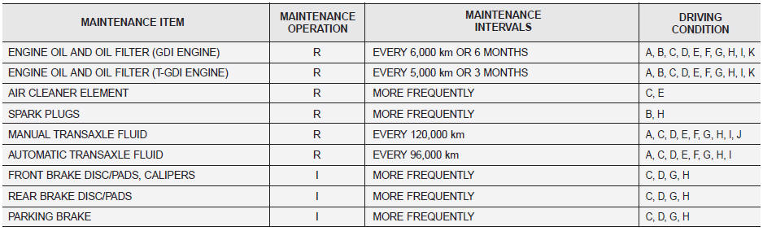
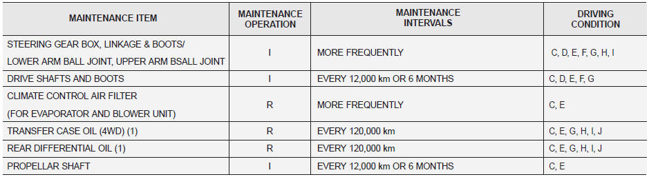

# Manutenção do Kia Sportage em condições severas de uso

[Início](../../index.md) / [Manual do Proprietário do Kia Sportage SL](../sportage-1236.md) / [Manutenção](sportage-1629.md) / Manutenção em condições severas de uso

Os seguintes itens devem ser servidos com mais frequência em veículos normalmente utilizados em condições severas de uso. Consulte o gráfico abaixo para as respectivas intervalos de manutenção.

R : Substituir

I : Inspeção e, após a inspeção, limpeza, ajuste, reparo ou substituição se necessário

(1) O óleo do caixa de transferência e o óleo do eixo traseiro devem ser substituídos a qualquer momento que tenham estado imersos em água.

CONDIÇÕES DE USO SEVERAS

A - Dirigir repetidamente por curtos distâncias de menos de 8 km (5 milhas) em temperatura normal ou menos de 16 km (10 milhas) em temperatura congelante

B - Extensa parada do motor em baixa velocidade ou dirigir por longas distâncias em baixa velocidade

C - Dirigir em estradas irregulares, poeirentas, lodosas, não asfaltadas, com pedras ou sal espalhado

D - Dirigir em áreas que utilizam sal ou outros materiais corrosivos ou em condições muito frias

E - Dirigir em áreas arenosas

F - Dirigir em áreas de tráfego pesado acima de 32°C (90°F)

G - Dirigir em estradas de subida, descida ou montanha

H - Remover um trailer, ou usar um camping-car, ou rack no teto

I - Dirigir como carro de patrulha, táxi, uso comercial ou remoção de veículo

J - Dirigir acima de 170 km/h (106 mph)

K - Dirigir frequentemente em condições de parada e arranque
