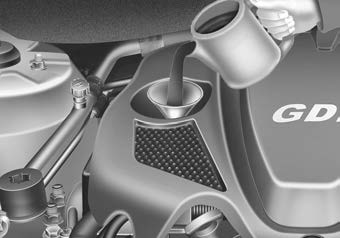
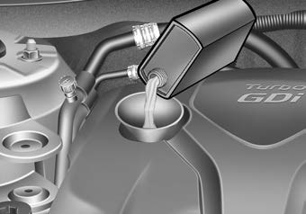

# Kia Sportage: Verificando o nível do óleo do motor

[Home](../../index.md) / [Manual do proprietário Kia Sportage SL](../sportage-1236.md) / [Manutenção](sportage-1629.md) / [Óleo do motor](sportage-1639.md) / Verificando o nível do óleo do motor

1. Certifique-se de que o veículo está em terreno nivelado.

2. Ligue o motor e aguarde que atinja a temperatura de operação normal.

3. Desligue o motor e aguarde alguns minutos (aproximadamente 5 minutos) para que o óleo retorne à vassoura.

4. Remova a régua do óleo, limpe-a e reintroduza-a completamente.

AVISO - Mangueira do radiador

*Seja muito cuidadoso ao tocar na mangueira do radiador ao verificar ou adicionar o óleo do motor, pois ela pode estar quente o suficiente para queimar.*

5. Remova a régua do óleo novamente e verifique o nível. O nível deve estar entre F e L.

CUIDADO - Troca do óleo do motor

*Não sobrecheie o óleo do motor. Isso pode danificar o motor.*

Não derrame óleo do motor ao adicionar ou trocar o óleo. Se você soltar óleo do motor na câmara do motor, limpe-o imediatamente.

Motor GDI

Motor T-GDI

Se estiver próximo ou no nível L, adicione o suficiente de óleo para trazer o nível até F. Não sobrecheie.

**Use um funil para ajudar a prevenir o derramamento de óleo sobre os componentes do motor.**

Utilize apenas o óleo do motor especificado. (Consulte a “Lubrificantes recomendados e capacidades” na seção 8.)
