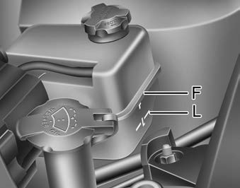
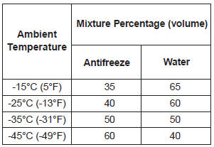

# Kia Sportage: Verificando o nível do líquido de resfriamento

[Home](../../index.md) / [Manual do proprietário Kia Sportage SL](../sportage-1236.md) / [Manutenção](sportage-1629.md) / [Líquido de resfriamento](sportage-1642.md) / Verificando o nível do líquido de resfriamento

AVISO - Remoção da tampa do radiador

**

*Nunca tente remover a tampa do radiador enquanto o motor estiver em funcionamento ou quente. Fazê-lo pode levar a danos no sistema de resfriamento e no motor.*

Além disso, o líquido de resfriamento quente ou vapor podem causar ferimentos graves.

Desligue o motor e espere que ele esfrie. Use cuidado extremo ao remover a tampa do radiador. Envolva-a em um pano grosso e vire-a lentamente no sentido horário até a primeira parada. Deixe de lado enquanto a pressão é liberada do sistema de resfriamento. Quando você estiver certo de que toda a pressão foi liberada, pressione a tampa, usando um pano grosso, e continue girando no sentido horário para removê-la.

AVISO - Fan de resfriamento

**

*Use cuidado ao trabalhar perto do disco do fan de resfriamento. O motor elétrico (fan de resfriamento) é controlado pela temperatura do líquido de resfriamento, pela pressão do refrigerante e pela velocidade do veículo. Ele pode operar mesmo quando o motor não estiver em funcionamento.*

Verifique a condição e as conexões de todas as mangueiras do sistema de resfriamento e as mangueiras do aquecedor. Substitua quaisquer mangueiras inchadas ou deterioradas.

O nível do líquido de resfriamento deve estar entre as marcas F e L na lateral do reservatório do líquido de resfriamento quando o motor estiver frio.

Se o nível do líquido de resfriamento estiver baixo, adicione água distilada (deionizada) suficiente para proteger contra congelamento e corrosão. Levante o nível até a marca F, mas não sobrepreencha. Se forem necessárias adições frequentes, consulte um concessionário autorizado Kia para uma inspeção do sistema de resfriamento.

**Líquido de resfriamento recomendado**

- Ao adicionar líquido de resfriamento, use apenas água distilada ou água macia para o seu veículo e nunca misture água dura no líquido de resfriamento preenchido fábrica. Uma mistura inadequada de líquido de resfriamento pode resultar em falhas graves ou danos ao motor.
- O motor do seu veículo tem partes do motor em alumínio e deve ser protegido por um líquido de resfriamento com base em glicol etílico com base em fosfato para prevenir corrosão e congelamento.
- NÃO USE líquido de resfriamento à base de álcool ou metanol ou misture-os com o líquido de resfriamento especificado.
- Não use uma solução que contenha mais de 60% de antifreeze ou menos de 35% de antifreeze, o que reduziria a eficácia da solução.

Para a porcentagem da mistura, consulte a tabela a seguir.

