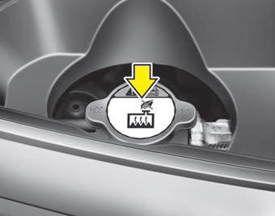

# Kia Sportage: Trocar o líquido de resfriamento

[Início](../../index.md) / [Manual do proprietário do Kia Sportage SL](../sportage-1236.md) / [Manutenção](sportage-1629.md) / [Líquido de resfriamento do motor](sportage-1642.md) / Trocar o líquido de resfriamento

AVISO - Copo do radiador

**

*Não remova o copo do radiador quando o motor e o radiador estiverem quentes. O líquido de resfriamento e a vapor podem ser expelidos sob pressão, causando ferimentos graves.*

Tenha a troca do líquido de resfriamento realizada por um concessionário autorizado da Kia de acordo com o Agendamento de Manutenção no início desta seção.

Envolva um pano grosso no copo do radiador antes de refilá-lo com o líquido de resfriamento para evitar que o líquido de resfriamento transborde para partes do motor, como o gerador.
