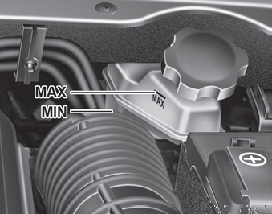

# Kia Sportage: Fluido de freio/embreagem

[Home](../../index.md) / [Manual do proprietário Kia Sportage SL](../sportage-1236.md) / [Manutenção](sportage-1629.md) / Freio / embreagem

**Verificação do nível do fluido de freio/embreagem**

Verifique o nível do fluido no reservatório periodicamente. O nível do fluido deve estar entre as marcas MAX e MIN do lado do reservatório.

Antes de remover a tampa do reservatório e adicionar fluido de freio/embreagem, limpe a área ao redor da tampa do reservatório para prevenir a contaminação do fluido de freio/embreagem.

Se o nível estiver baixo, adicione fluido até o nível MAX. O nível cai com o acúmulo de quilometragem. Esta é uma condição normal associada ao desgaste das pastilhas de freio e/ou disco de embreagem (se equipado). Se o nível do fluido estiver excessivamente baixo, faça a verificação do sistema de freio/embreagem em um concessionário autorizado da Kia.

Utilize apenas o fluido de freio/embreagem especificado. (Consulte a "Lubrificantes recomendados e capacidades" na seção 8.)

Nunca misture diferentes tipos de fluido.

No caso de o sistema de freio/embreagem exigir adições frequentes de fluido, o veículo deve ser inspecionado em um concessionário autorizado da Kia.

Ao trocar e adicionar fluido de freio/embreagem, trate com cuidado. Não permita que entre em contato com os olhos. Se o fluido de freio/embreagem entrar em contato com os olhos, lave-os imediatamente com uma grande quantidade de água potável. Tenha os olhos examinados por um médico o mais rápido possível.

CAUTION - Fluido Apropriado

*Só use fluido de freio/embreagem no sistema de freio/embreagem. Pequenas quantidades de fluidos inadequados (como óleo do motor) podem causar danos ao sistema de freio/embreagem.*

CAUTION - Fluido de freio/embreagem

*Não permita que o fluido de freio/embreagem entre em contato com a pintura do corpo do veículo, pois danos à pintura resultarão.*

O fluido de freio/embreagem exposto ao ar por um período prolongado nunca deve ser usado, pois sua qualidade não pode ser garantida. Ele deve ser descartado corretamente.
