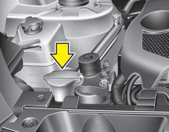

# Kia Sportage: Liquido de lavagem

[Home](../../index.md) / [Manual do proprietário Kia Sportage SL](../sportage-1236.md) / [Manutenção](sportage-1629.md) / Liquido de lavagem

**Verificação do nível de liquido de lavagem**

Verifique o nível do liquido de lavagem no reservatório e adicione mais liquido se necessário.
Água pura pode ser usada se o liquido de lavagem não estiver disponível. No entanto, use solvente de vidro com características de antifreeze em climas frios para prevenir o congelamento.

AVISO - Fluido inflamável

*Não permita que o liquido de lavagem entre em contato com chamas acesas ou chispas.
O reservatório de lavagem do vidro pode ser inflamável em certas circunstâncias.
Isso pode resultar em um incêndio.*
