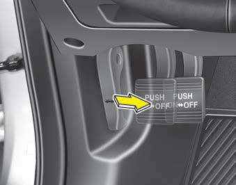
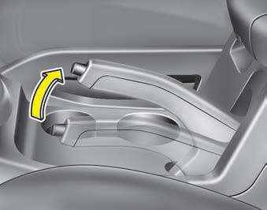

# Kia Sportage: Freio de estacionamento

[Home](../../index.md) / [Manual do proprietário Kia Sportage SL](../sportage-1236.md) / [Manutenção](sportage-1629.md) / Freio de estacionamento

**Verificação do freio de estacionamento**

**Tipo A**

Verifique se o recuo está dentro da especificação quando o pedal do freio de
estacionamento é pressionado com uma força de 20 kg (44 lb, 196 N). Além disso, o
freio de estacionamento sozinho deve segurar o veículo em uma inclinação relativamente
estreita. Se o recuo for mais ou menos do especificado, tenha o freio de
estacionamento ajustado por um concessionário autorizado da Kia.

Recuo: 4~5 notches

**Tipo B**

Verifique o recuo do freio de estacionamento contando o número de “clicks” ouvidos
enquanto o freio é totalmente aplicado a partir da posição liberada. Além disso, o
freio de estacionamento sozinho deve segurar o veículo em uma inclinação relativamente
estreita. Se o recuo for mais ou menos do especificado, tenha o freio de
estacionamento ajustado por um concessionário autorizado da Kia.

Recuo: 5~6 “clicks” a uma força de 20 kg (44 lbs, 196 N).
