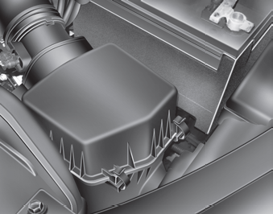

# Kia Sportage: Filtro de ar

[Home](../../index.md) / [Manual do proprietário Kia Sportage SL](../sportage-1236.md) / [Manutenção](sportage-1629.md) / Filtro de ar

**Troca do filtro**

Deve ser substituído quando necessário e não deve ser lavado.

Você pode limpar o filtro durante a inspeção do elemento do filtro de ar.

Limpe o filtro usando ar comprimido.

Substitua o filtro de acordo com o Agendamento de Manutenção.

Se o veículo for operado em áreas extremamente poluídas ou cheias de areia, substitua o elemento com mais frequência do que as intervalos recomendados.

CAUTION - Manutenção do filtro de ar

- *Não dirija com o filtro de ar removido; isso resultará em desgaste excessivo do motor.*
- *Ao remover o filtro de ar, tenha cuidado para que poeira ou sujeira não entre na entrada de ar, ou danos podem ocorrer.*
- *Use um componente genuíno Kia. O uso de componentes não genuínos pode danificar o sensor de fluxo de ar.*
