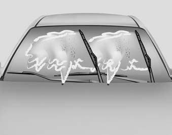

# Kia Sportage: Verificação das Lâminas de Escova

[Home](../../index.md) / [Manual do Proprietário do Kia Sportage SL](../sportage-1236.md) / [Manutenção](sportage-1629.md) / [Escovas de limpador](sportage-1650.md) / Verificação das Lâminas de Escova

Líquidos químicos comerciais, como os hot waxes aplicados por lavadoras automáticas de carros, podem tornar difícil a limpeza do vidro.

Contaminação do vidro ou das lâminas de escova com materiais estranhos pode reduzir a eficácia das escovas de limpador. Fontes comuns de contaminação incluem insetos, resina de árvores e tratamentos de cera quente utilizados por algumas lavadoras comerciais de carros. Se as lâminas não estiverem limpando corretamente, limpe tanto o vidro quanto as lâminas com um bom limpador ou um detergente suave e lave bem com água limpa.

CAUTION - Lâminas de escova

*Para prevenir danos às lâminas de escova, não use gasolina, kerosene, dissolvente de tinta ou outros solventes nelas ou nas proximidades.*
