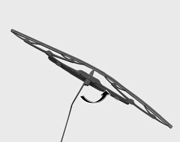
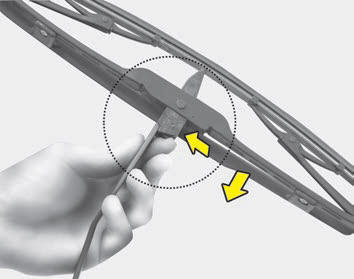
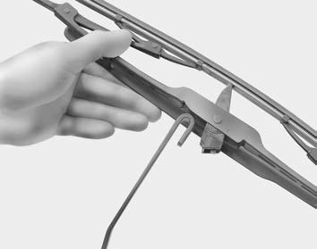

# Kia Sportage: Pás de limpador do para-brisa frontal

[Home](../../index.md) / [Manual do proprietário Kia Sportage SL](../sportage-1236.md) / [Manutenção](sportage-1629.md) / [Pás de limpador](sportage-1650.md) / [Troca da pás](sportage-1652.md) / Pás de limpador do para-brisa frontal

1. Eleva o braço do limpador e vira a montagem da pás para expor o clip de vedação plástico.

ATENÇÃO - Braços dos limpadores

*Não permita que o braço do limpador caia contra o para-brisa, pois pode riscar ou quebrar o para-brisa.*

2. Comprime o clip e deslize a montagem da pás para baixo

3. Levante-a do braço.

4. Instale a montagem da pás na ordem inversa à remoção.
