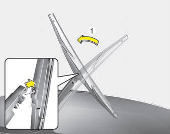
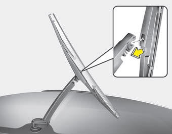

# Kia Sportage: Troca da lâmina do limpador do vidro traseiro

[Home](../../index.md) / [Manual do proprietário do Kia Sportage SL](../sportage-1236.md) / [Manutenção](sportage-1629.md) / [Lâminas do limpador](sportage-1650.md) / [Troca da lâmina](sportage-1652.md) / Lâmina do vidro traseiro

1. Levante o braço do limpador e retire a montagem da lâmina do limpador.

2. Instale a nova montagem da lâmina inserindo a parte central na vaga no braço do limpador até ouvir o clique.

3. Certifique-se de que a montagem da lâmina está instalada firmemente tentando puxá-la levemente.

Para evitar danos aos braços do limpador ou a outros componentes, tenha um concessionário autorizado da Kia realizando a troca da lâmina.
