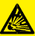

# Kia Sportage: Para o melhor serviço da bateria

[Home](../../index.md) / [Manual do Proprietário Kia Sportage SL](../sportage-1236.md) / [Manutenção](sportage-1629.md) / [Bateria](sportage-1655.md) / Para o melhor serviço da bateria

- Mantenha a bateria firmemente fixada.
- Manter o topo da bateria limpo e seco.
- Manter os terminais e as conexões limpos, apertados e revestidos com cera de petróleo ou graxa para terminais.
- Enxaguar qualquer eletrólito derramado na bateria imediatamente com uma solução de água e bicarbonato de sódio.
- Se o veículo não for usado por um tempo prolongado, desconecte as barras da bateria.

AVISO - Risco de explosão

*Manter cigarros acesos
e todos os outros fósforos ou chamas longe da bateria.*

*A bateria contém
hidrogênio -- um gás altamente inflamável que explodirá se entrar em contato com
uma chama ou fagulha.*

*Manter as baterias
longe das crianças, pois as baterias contêm ácido sulfúrico altamente corrosivo e eletrólitos. Não permita que ácido da bateria entre em contato com sua pele, olhos, roupas ou acabamento de pintura.*

*Usar proteção ocular
quando recarregar ou trabalhar perto de uma bateria. Sempre fornecer ventilação ao trabalhar em um espaço fechado.*

*Sempre ler as
instruções a seguir cuidadosamente ao lidar com uma bateria.*

*Se qualquer eletrólito
entrar nos seus olhos, enxágue os olhos com água limpa por pelo menos 15 minutos e procure atendimento médico imediato.*

*Se eletrólito
entrar em sua pele, lave a área em contato. Se você sentir dor ou sensação de queimação, procure atendimento médico imediatamente.*

*Uma bateria mal descartada pode ser prejudicial ao meio ambiente e à saúde humana. Descarte a bateria de acordo com a lei local ou regulamentação.*

Nunca tente recarregar a bateria quando as barras da bateria estão conectadas.

AVISO - Risco de choque elétrico

*Nunca toque no sistema de ignição elétrico enquanto o veículo estiver em funcionamento. Este sistema trabalha com alta tensão que pode "zap" você.* 

*✽ NOTA

*Não conecte dispositivos eletrônicos não autorizados à bateria. A bateria pode ser descarregada. Nunca use dispositivos não autorizados.*
