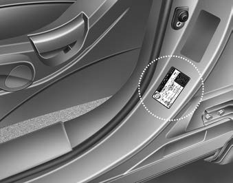

# Kia Sportage: Pressões de inflação de pneus em temperatura ambiente recomendadas

[Home](../../index.md) / [Manual do proprietário Kia Sportage SL](../sportage-1236.md) / [Manutenção](sportage-1629.md) / [Pneus e rodas](sportage-1659.md) / Pressões de inflação de pneus em temperatura ambiente recomendadas

Todas as pressões dos pneus (incluindo o pneu de emergência) devem ser verificadas quando os pneus estiverem frios. "Pneus frios" significa que o veículo não foi conduzido há pelo menos três horas ou menos de 1,6 km (um quilômetro).

As pressões recomendadas devem ser mantidas para o melhor conforto, manuseio do veículo e mínimo desgaste dos pneus.

Para as pressões de inflação recomendadas, consulte "Pneus e rodas" na seção 8.

Todas as especificações (tamanhos e pressões) podem ser encontradas em uma etiqueta fixada no pilar central do lado do motorista.

AVISO - Pneu subinflado

*Inflame seus pneus de acordo com as instruções fornecidas neste manual. Uma subinflação severa pode levar a um aumento severo de calor, causando estouramentos, separação do sulco e outros problemas de pneu que podem resultar na perda do controle do veículo. Esse risco é muito maior em dias quentes e ao dirigir por longos períodos a altas velocidades.*

- Subinflação também resulta em desgaste excessivo, pior manuseio e economia de combustível reduzida. A deformação da roda também é possível. Mantenha as pressões dos pneus nos níveis corretos. Se um pneu precisar ser reabastecido com frequência, leve-o a um concessionário autorizado da Kia para ser verificado.
- Superinflação produz um passeio áspero, desgaste excessivo no centro do sulco do pneu e uma maior probabilidade de danos devido a obstáculos na estrada.
- Pneus aquecidos normalmente excedem as pressões recomendadas de pneus frios em 28 a 41 kPa (4 a 6 psi). Não libere ar dos pneus aquecidos para ajustar a pressão, pois os pneus ficarão subinflados.
- Certifique-se de reinstalar as tampas de válvula de inflação dos pneus. Sem a tampa de válvula, sujeira ou umidade podem entrar na parte central da válvula e causar vazamento de ar. Se uma tampa de válvula estiver faltando, instale uma nova o mais rápido possível.

Sempre observe o seguinte:

- Verifique a pressão dos pneus quando os pneus estiverem frios. (Após o veículo ter sido parado por pelo menos três horas ou menos de 1,6 km (um quilômetro) desde o início da viagem.)
- Verifique a pressão do pneu de emergência toda vez que verificar a pressão dos outros pneus.
- Nunca sobrecarregue o veículo. Se o veículo estiver equipado com um rack de bagagem, tenha cuidado ao não sobrecarregá-lo.
- Pneus usados ou velhos podem causar acidentes. Se o sulco estiver muito usado ou se os pneus estiverem danificados, substitua-os.
