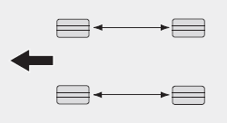

# Kia Sportage: Troca de pneus

[Home](../../index.md) / [Manual do proprietário Kia Sportage SL](../sportage-1236.md) / [Manutenção](sportage-1629.md) / [Pneus e rodas](sportage-1659.md) / Troca de pneus

Para igualar o desgaste da banda de rodagem, recomenda-se a troca de pneus a cada 12.000 km (7.500 milhas) ou antes, se surgir desgaste irregular.

Durante a troca, verifique o equilíbrio dos pneus.

Ao trocar pneus, verifique o desgaste irregular e o dano. Um desgaste anormal geralmente é causado por pressão do pneu incorreta, alinhamento da roda incorreto, rodas fora de equilíbrio, frenagem severa ou curvas severas. Procure por altas ou protuberâncias na banda de rodagem ou na lateral do pneu. Substitua o pneu se encontrar qualquer uma dessas condições. Substitua o pneu se a fibra ou o fio for visível. Após a troca, certifique-se de trazer as pressões do pneu dianteiro e traseiro para as especificações e verifique a apertura dos parafusos de fixação.

Consulte “Pneus e rodas” na seção 8.

Sem pneu de备胎

Pneus direcionais

Os discos de freio das rodas dianteiras devem ser inspecionados para desgaste sempre que os pneus forem trocados.

Troque os pneus radiais que possuem uma banda de rodagem assimétrica apenas de dianteiro para traseiro e não de lado a lado.

Não use o pneu de emergência compacto para troca de pneus.

AVISO - Mistura de tipos de pneus

*Não misture pneus de pano de lona e pneus radiais sob qualquer circunstância. Isso pode causar características de condução incomuns.*
