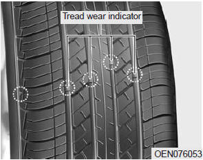

# Kia Sportage: Troca de pneus

[Início](../../index.md) / [Manual do proprietário do Kia Sportage SL](../sportage-1236.md) / [Manutenção](sportage-1629.md) / [Pneus e rodas](sportage-1659.md) / Troca de pneus

Se o pneu estiver desgastado de forma uniforme, um indicador de desgaste do sulco aparecerá como uma faixa sólida no sulco. Isso indica que há menos de 1,6 mm (1/16 polegada) de sulco restante no pneu. Substitua o pneu quando isso acontecer.

Não espere que a faixa apareça em toda a largura do sulco antes de substituir o pneu.

O ABS funciona comparando a velocidade das rodas. O tamanho do pneu afeta a velocidade da roda. Ao substituir pneus, todos os 4 pneus devem usar o mesmo tamanho originalmente fornecido com o veículo. Usar pneus de tamanhos diferentes pode causar o ABS (Sistema de Freio de Emergência Anti-arranhão) e o ESC (Controle de Estabilidade Eletrônico) a funcionarem irregularmente.

*NOTA*

*Recomendamos que, ao substituir pneus, use os originais fornecidos com o veículo. Caso contrário, isso afeta o desempenho de direção.*

- [Troca de pneu de emergência compacto](sportage-1666.md)
