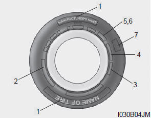
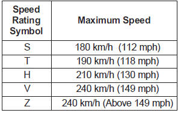

# Kia Sportage: Etiquetagem do flanco do pneu

[Home](../../index.md) / [Manual do proprietário do Kia Sportage SL](../sportage-1236.md) / [Manutenção](sportage-1629.md) / [Pneus e rodas](sportage-1659.md) / Etiquetagem do flanco do pneu

Essas informações identificam e descrevem as principais características do pneu e fornecem o número de identificação do pneu (NIP) para a certificação de padrões de segurança. O NIP pode ser usado para identificar o pneu em caso de chamada de recall.

**1. Nome do fabricante ou marca**

O nome do fabricante ou marca é exibido.

**2. Designação do tamanho do pneu**

O flanco do pneu é marcado com uma designação de tamanho do pneu. Você precisará dessas informações ao selecionar pneus de reposição para seu veículo. O seguinte explica o significado das letras e números na designação do tamanho do pneu.

Exemplo de designação do tamanho do pneu: (Estes números são fornecidos apenas como exemplo; a designação do tamanho do seu pneu pode variar dependendo do seu veículo.)

P235/55R18 98H

P - Tipo de veículo aplicável (pneus marcados com o prefixo "P" são destinados para uso em veículos leves ou caminhonetes; no entanto, nem todos os pneus têm essa marcação).

235 - Diâmetro do pneu em milímetros.

55 - Razão de aspecto. A altura da seção do pneu como porcentagem de sua largura.

R - Código de construção do pneu (Radial).

18 - Diâmetro do rolo em polegadas.

98 - Índice de carga, um código numérico associado ao máximo de carga que o pneu pode carregar.

H - Símbolo de classificação de velocidade. Consulte a tabela de classificação de velocidade nesta seção para informações adicionais.

**Designação do tamanho da roda**

As rodas também são marcadas com informações importantes que você precisa se precisar substituí-las. O seguinte explica o significado das letras e números na designação do tamanho da roda.

Exemplo de designação do tamanho da roda: 7.0JX18

7.0 - Diâmetro do rolo em polegadas.

J - Designação da forma do rolo.

18 - Diâmetro do rolo em polegadas.

**Classificação de velocidade do pneu**

A tabela abaixo lista muitas das diferentes classificações de velocidade atualmente em uso para pneus de veículos leves. A classificação de velocidade faz parte da designação do tamanho do pneu no flanco do pneu. Este símbolo corresponde à velocidade máxima segura operacional projetada para esse pneu.

A tabela abaixo lista muitas das diferentes classificações de velocidade atualmente em uso para pneus de veículos leves. A classificação de velocidade faz parte da designação do tamanho do pneu no flanco do pneu. Este símbolo corresponde à velocidade máxima segura operacional projetada para esse pneu.

**3. Verificação da vida útil do pneu (NIP: Número de Identificação do Pneu)**

Qualquer pneu que tenha mais de 6 anos de fabricação, incluindo o pneu de备忘录：此处应为“备忘录”而非“Sportage”，但考虑到原文中Sportage是车型名称，此处保持Sportage不变。

A parte inicial do DOT indica um código de fábrica, o tamanho da rodada e o padrão de sulcos, e os últimos quatro números indicam a semana e o ano de fabricação.

Por exemplo:

DOT XXXX XXXX 1615 representa que a rodada foi produzida na 16ª semana de 2015.

AVISO - Idade da rodada

*Substitua as rodas dentro do prazo recomendado. Falta de substituição conforme recomendado pode resultar em falhas repentina das rodas, o que pode levar a uma perda de controle e a um acidente.*

**4. Composição e material das camadas da rodada**

O número de camadas ou camadas de tecido revestido de borracha na rodada. Os fabricantes de rodas também devem indicar os materiais na rodada, que incluem aço, níquel, poliéster e outros. A letra "R" significa construção de camadas radiais; a letra "D" significa construção diagonal ou de camadas oblíquas; e a letra "B" significa construção de camadas com cintas.

**5. Pressão de inflação máxima permitida**

Este número é a maior quantidade de ar que deve ser inserida na rodada. Não ultrapasse a pressão de inflação máxima permitida. Consulte a etiqueta de informações da rodada e carga para a pressão de inflação recomendada.

**6. Classificação máxima de carga**

Este número indica a carga máxima em quilogramas e libras que pode ser transportada pela rodada. Ao substituir as rodas no veículo, sempre use uma rodada com a mesma classificação de carga da rodada originalmente instalada no fabricante.

**7. Avaliação de qualidade uniforme da rodada**

As classificações de qualidade podem ser encontradas, se aplicáveis, na lateral da rodada entre o ombro do sulco e a largura máxima da seção.

Por exemplo:

PISOS DE USO 200

ADERÊNCIA AA

TEMPERATURA A

As rodas se deterioram com o tempo, mesmo quando não estão em uso. Independentemente do restante do sulco, recomendamos a substituição das rodas após aproximadamente seis (6) anos de serviço normal. O calor causado por climas quentes ou condições de carga frequente e alta pode acelerar o processo de envelhecimento.

**Pisos de uso**

A classificação de uso do sulco é uma classificação comparativa com base na taxa de desgaste da rodada quando testada em condições controladas em um curso de teste governamental especificado. Por exemplo, uma rodada classificada 150 usaria 1,5 vezes (1½) mais rápido do que uma rodada classificada 100 no curso governamental.

A performance relativa das rodas depende das condições de uso reais e pode se desviar significativamente da norma devido às variações no hábito de condução, práticas de serviço e diferenças nas características das estradas e climas.

Essas classificações são moldadas nas laterais das rodas de veículos de passageiros. As rodas disponíveis como equipamento padrão ou opcional no seu veículo podem variar em relação à classificação.

**Aderência - AA, A, B & C**

As classificações de aderência, de mais alta a mais baixa, são AA, A, B e C. Essas classificações representam a capacidade da rodada de frear em piso molhado, medida sob condições controladas em superfícies de asfalto e concreto governamentais. Uma rodada marcada C pode ter um desempenho de aderência ruim.

A classificação de aderência atribuída a esta rodada é baseada na aderência de frenagem em linha reta.

tests, e não inclui características de aceleração, curvatura, hidroplanagem ou tração de pico.

**Temperatura -A, B & C**

Os graus de temperatura são A (o mais alto), B e C, representando a resistência da pneumatização à geração de calor e à sua capacidade de dissipar calor quando testados em condições controladas em um rolo de teste laboratorial especificado.

Temperaturas elevadas prolongadas podem causar a degradação do material do pneu e reduzir a vida útil do pneu, e temperaturas excessivas podem levar a falhas súbitas do pneu. O grau C corresponde ao nível de desempenho que todos os pneus de pneumatização para veículos leves devem atingir de acordo com o Estabelecimento Federal de Segurança Veicular No. 109. Os graus B e A representam níveis de desempenho superiores no rolo de teste laboratorial em comparação com o mínimo exigido pela lei.
