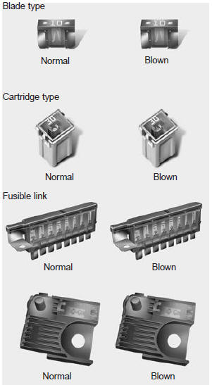

# Kia Sportage: Fusíveis

[Home](../../index.md) / [Manual do Proprietário Kia Sportage SL](../sportage-1236.md) / [Manutenção](sportage-1629.md) / Fusíveis

O sistema elétrico do veículo é protegido contra danos de sobrecarga elétrica por fusíveis.

Este veículo tem 3 painéis de fusíveis, um localizado no suporte do painel do lado do motorista, o outro no compartimento do motor perto da bateria.

Se alguma luz, acessório ou controle do seu veículo não funcionar, verifique o fusível correspondente à circuito. Se um fusível estiver queimado, o elemento dentro do fusível derreterá.

Se o sistema elétrico não funcionar, verifique primeiro o painel do lado do motorista.

Antes de substituir um fusível queimado, desconecte o cabo negativo da bateria. Sempre substitua um fusível queimado por um de mesmo rating.

Se o novo fusível queimar, isso indica um problema elétrico. Evite usar o sistema envolvido e consulte imediatamente um concessionário autorizado da Kia.

Três tipos de fusíveis são utilizados: tipo de lâmina para classificação de amperagem mais baixa, tipo de carregador, e fusível multi para classificação de amperagem mais alta.

AVISO - Substituição de fusíveis

- *Nunca substitua um fusível com qualquer outro item de mesmo rating.*
- *Um fusível com capacidade maior poderia causar danos e, possivelmente, um incêndio.*
- *Nunca instale um fio ou papel de alumínio no lugar do fusível correto - mesmo como reparo temporário. Isso pode causar danos extensos aos fios e um possível incêndio.*
- *Não modifique ou adicione eletrônicos ao veículo sem motivo.*

*✽ NOTA*

*O rótulo do painel de fusíveis/relé pode diferir dependendo do equipamento/opções.*

CAUTION

*Não use uma furadeira ou qualquer outro objeto metálico para remover fusíveis, pois isso pode causar curto-circuito e danificar o sistema.*

AVISO - Incêndio de fusível

- *Ao substituir um fusível ou relé queimado por um novo, certifique-se de que o novo fusível ou relé se encaixe firmemente nas garras. Um fusível ou relé mal encaixado pode causar danos aos fios elétricos do veículo e aos sistemas elétricos e um possível incêndio.*
- *Não remova fusíveis, relés e terminais fixados com parafusos ou engrenagens. Esses fusíveis, relés e terminais podem estar mal fixados e podem causar um possível incêndio no veículo. Se fusíveis, relés e terminais fixados com parafusos ou engrenagens estiverem queimados, recomendamos que você consulte um concessionário autorizado da Kia para que sejam substituídos corretamente.*

- [Substituição de fusíveis do painel interno](sportage-1678.md)
- [Substituição de fusíveis no compartimento do motor](sportage-1680.md)
- [Descrição do painel de fusíveis/relé](sportage-1682.md)
- [Painel de fusíveis do painel do instrumento](sportage-1683.md)
- [Painel de fusíveis no compartimento do motor](sportage-1684.md)
- [Painel de fusíveis no compartimento do motor](sportage-1685.md)
- [Especificação](sportage-1686.md)
