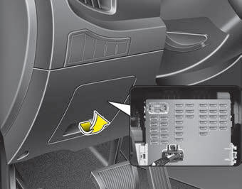
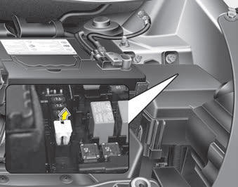

# Kia Sportage: Troca da fusível no painel interno

[Home](../../index.md) / [Manual do proprietário Kia Sportage SL](../sportage-1236.md) / [Manutenção](sportage-1629.md) / [Fusíveis](sportage-1677.md) / Troca da fusível no painel interno

1. Desligue o interruptor da ignição e todos os outros interruptores.

2. Abra a tampa do painel de fusíveis.

3. Retire o fusível suspeito de maneira direta. Use a ferramenta de remoção fornecida na tampa do painel de fusíveis do compartimento do motor.

4. Verifique o fusível removido; substitua se estiver quebrado. Fusíveis de reserva estão disponíveis na tampa do painel de fusíveis do compartimento do motor.

5. Empurre um novo fusível do mesmo rating e certifique-se de que ele se encaixe firmemente nas garras.

Se ele se encaixar松松地，咨询授权的Kia经销商。

如果没有备用的，可以使用来自可能不需要用于操作车辆的电路的相同评级的熔丝，例如电源插座熔丝。

如果前照灯或其他电气组件不工作且熔丝正常，检查发动机舱内的熔丝盒。如果熔丝断了，必须更换。

- [Fusível de memória](sportage-1679.md)
