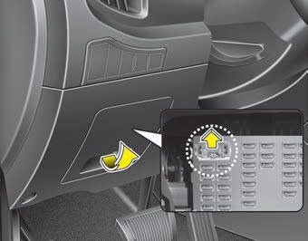

# Kia Sportage: Fusível de Memória

[Início](../../index.md) / [Manual do Proprietário do Kia Sportage SL](../sportage-1236.md) / [Manutenção](sportage-1629.md) / [Fusíveis](sportage-1677.md) / [Troca do fusível no painel interno](sportage-1678.md) / Fusível de Memória

Seu veículo está equipado com um fusível de memória para prevenir a descarga da bateria se o veículo estiver estacionado sem ser operado por períodos prolongados. Use as seguintes procedimentos antes de estacionar o veículo por períodos prolongados.

1. Desligue o motor.

2. Desligue as luzes de cabeça e as luzes de ré.

3. Abra a capa do painel do lado do motorista e retire o fusível de memória.

*✽ NOTA*

- *Se o fusível de memória for retirado do painel de fusíveis, o chiado de advertência, o som, o relógio e as luzes internas, etc., não funcionarão. Alguns itens devem ser reconfigurados após a substituição. Consulte "Bateria" nesta seção.*
- *Mesmo que o fusível de memória seja retirado, a bateria ainda pode ser descarregada pela operação das luzes de cabeça ou de outros dispositivos elétricos.*
