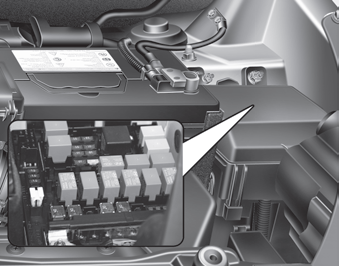

# Kia Sportage: Troca de fusíveis no compartimento do motor

[Home](../../index.md) / [Manual do proprietário Kia Sportage SL](../sportage-1236.md) / [Manutenção](sportage-1629.md) / [Fusíveis](sportage-1677.md) / Troca de fusíveis no compartimento do motor

1. Desligue a chave do motor e todos os outros interruptores.

2. Remova a capa do painel de fusíveis pressionando o enganche e levantando a capa. Quando o fusível do tipo lâmina estiver desligado, remova-o usando o enganche projetado para a troca de fusíveis localizado na caixa de fusíveis do motor. Ao remover, insira o fusível de reserva do mesmo tipo.

3. Verifique o fusível removido; substitua se estiver queimado. Para remover ou inserir o fusível, use o desengavetador de fusíveis na capa do painel de fusíveis do motor.

4. Empurre um novo fusível do mesmo tipo e certifique-se de que ele se encaixe firmemente nas enganches.

Se ele se encaixar com folga, consulte um concessionário autorizado da Kia.

AVISO - Capas de painel de fusíveis

*Depois de verificar o painel de fusíveis no compartimento do motor, instale
seguramente a capa do painel de fusíveis. Caso contrário, falhas elétricas podem ocorrer devido ao contato com água.*

- [Fusível principal e fusível multifunção](sportage-1681.md)
