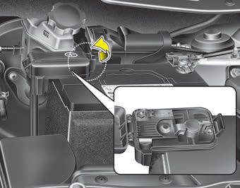

# Kia Sportage: Fusível principal e fusível multifuncional

[Home](../../index.md) / [Manual do proprietário Kia Sportage SL](../sportage-1236.md) / [Manutenção](sportage-1629.md) / [Fusíveis](sportage-1677.md) / [Troca de fusível no compartimento do motor](sportage-1680.md) / Fusível principal e fusível multifuncional

Se o fusível principal e multifuncional estiver quebrado, ele deve ser removido conforme indicado:

1. Desconecte o cabo negativo da bateria.

2. Remova as varetas de desengate indicadas na imagem acima.

3. Substitua o fusível por um novo do mesmo rating.

4. Reinstale na ordem inversa da remoção.

*✽ NOTA DE SEGURANÇA*

*Se o fusível multifuncional estiver quebrado, consulte um concessionário autorizado da Kia.*

CAUTION

*Verifique visualmente a tampa da bateria para garantir que está bem fechada. Se a tampa da bateria não estiver bem fechada, a umidade pode entrar no sistema e danificar os componentes elétricos.*
